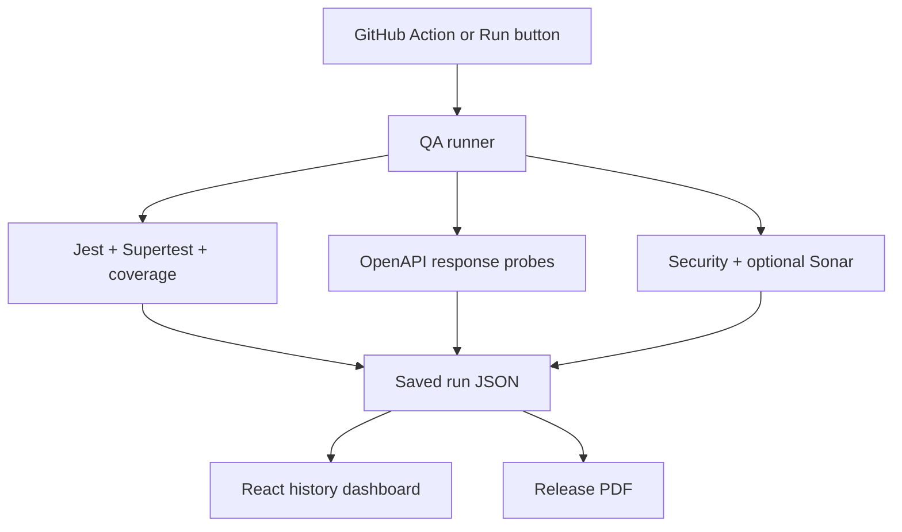

# Automated API Compliance Testing & Software Metrics Dashboard

This is **project 3 of 3** for a Software Engineer I portfolio. It is an internal-style engineering tool that checks two small Express APIs, blocks failing quality gates, records measurements, and displays run history in React. A major release tag (`vN.0.0`) generates a PDF evidence report in GitHub Actions. The included services and data are synthetic examples; the PDF is an engineering record, **not** a compliance certification.

## Quick start

Requirements: Node 20+, npm, network access for npm's advisory feed, and optionally Docker Compose.

```bash
npm ci
npm --prefix frontend ci
node runner/cli.cjs
npm --prefix frontend run build
npm start
# In a second terminal:
npm --prefix frontend run dev
```

Open `http://localhost:5173`. The API listens at `http://localhost:3000`. Click **Run QA checks** to start another run and watch its status/history update. Or use `docker compose up --build` to start both containers. The API port binds to loopback in Compose. The first CLI run works even without a SonarQube server; the report marks SonarQube as `NOT_CONFIGURED`.

To generate a release-style PDF locally:

```bash
node runner/cli.cjs --release-tag v1.0.0
```

This stores the run JSON in `data/<run-id>.json` and the PDF in `artifacts/`. The archive includes one sample run JSON, its matching PDF, and a paired timing sample.

## Exact data flow of a QA run

1. The CLI or `POST /api/runs` invokes `runner/run.cjs`. The API accepts **no arbitrary repository path or shell command**: it uses two checked-in service definitions in `services.json`.
2. The runner starts checks for the registered `orders` and `users` services. In parallel mode, it evaluates both services concurrently, while a global dependency/code scan runs. In sequential mode, it evaluates services one at a time. Every run gets a UUID, UTC timestamps, commit SHA if available, timing, and check results.
3. For each service, `coverage.cjs` launches Jest as a child process using `execFile` (no shell). Jest runs the service's Supertest tests and writes a JSON test result plus Istanbul's `coverage-summary.json`. The runner reads **line coverage** and enforces `>=85%`. A test failure, missing coverage file, or value below 85 fails that service.
4. `contract.cjs` parses and validates the checked-in OpenAPI document. It disallows external `$ref` references. Every documented HTTP operation must have an `x-test-case` sample with a path, expected status and optional body. Supertest calls the actual Express app; the runner checks status and validates JSON response structure against the dereferenced response schema. A missing sample or mismatch fails the service.
5. `security.cjs` parses each connected service's source using Acorn and flags three narrow patterns: `eval`/`Function` execution, calls named `exec`/`execSync`, and `innerHTML` assignment. It also runs `npm audit --json --omit=dev` for the **root runtime dependencies**. A high/critical advisory, finding, audit error, or intentionally skipped audit makes the gate red. These are selective checks, **not a full OWASP Top 10 scan**. In particular, they do not prove freedom from injection, auth, cryptography, or business-logic flaws.
6. If `SONAR_HOST_URL` and `SONAR_TOKEN` are supplied, `sonar.cjs` queries SonarQube's measures and project quality gate for each configured key. An enabled Sonar connection/error or non-OK gate fails that service. Without the credentials, Sonar is explicitly `NOT_CONFIGURED` and is excluded from the pass decision.
7. The runner saves one JSON file per run with an atomic rename. The Express API reads the latest 30 files from `data/`; the dashboard polls every four seconds to show service tests, line coverage, contract probes, security status, duration, and history.
8. For a `vN.0.0` release, `report.cjs` reads the saved JSON, computes its SHA-256 digest, and creates a PDF with the commit, run ID, timestamp, gate results, coverage, contracts, optional Sonar status, security summary, and scope statement. GitHub Actions uploads the JSON/PDF as workflow artifacts, including on a failing gate for review.



### File map

| Location | Purpose |
| --- | --- |
| `services.json` | Allowlisted service paths and Sonar project keys |
| `examples/orders`, `examples/users` | Small API examples, Supertest cases, OpenAPI specs |
| `runner/coverage.cjs` | Jest execution and 85% line gate |
| `runner/contract.cjs` | OpenAPI schema and live app probes |
| `runner/security.cjs` | Selected AST checks and npm advisory audit |
| `runner/sonar.cjs` | Optional SonarQube measures and quality gate |
| `runner/run.cjs` | Concurrent or sequential orchestration and history |
| `runner/report.cjs` | PDF generation with digest of saved JSON |
| `api/server.cjs` | Run/history/status endpoints |
| `frontend/` | React metrics and history dashboard |
| `.github/workflows/quality.yml` | CI on pushes/PRs and PDF on `v*.0.0` tags |
| `artifacts/` | Sample report JSON/PDF and timing evidence |

## Measured results and how to reproduce them

The included sample run was executed locally with Node 24 in the authoring environment, npm lockfiles, and no SonarQube connection. Run `node runner/cli.cjs` yourself on Node 20+ to obtain your own record. Results can change as the npm advisory database changes.

| Sample measurement | Recorded value | Method |
| --- | ---: | --- |
| Orders tests | 5/5 passed | Jest + Supertest |
| Users tests | 5/5 passed | Jest + Supertest |
| Orders line coverage | 100% | Istanbul `coverage-summary.json` |
| Users line coverage | 100% | Istanbul `coverage-summary.json` |
| Services with coverage measured | 2/2 (100%) | Count of connected services with non-null line coverage |
| OpenAPI operations probed | 6/6 configured | 3 per service with `x-test-case` |
| Root runtime advisories | 0 total | `npm audit --json --omit=dev` at time of the sample run |
| Static heuristic findings | 0 | Three limited AST patterns on connected app files |
| Release report | 1 PDF | `--release-tag v1.0.0` and SHA-256 of matching JSON |

**“100% coverage monitoring” means 2/2 registered services had a coverage measurement**, not that a large production system has complete test coverage. The two small example apps happened to score 100% *line* coverage. The gate is 85%, and `tests/coverage.test.js` verifies that 84.99 fails while 85 passes. `node scripts/prove-gates.cjs` additionally runs a real service with an impossible 101% threshold and checks that unsafe dynamic evaluation is flagged.

### Checking the proposed 40% cycle reduction

```bash
node scripts/benchmark.cjs
```

This runs the same configured service checks sequentially, then in parallel, saving both JSON records and printing `(sequentialMs - parallelMs) / sequentialMs * 100`. In the included **one-pair** local sample, the sequential run was **4,730 ms**, the parallel run was **5,992 ms**, and the calculated change was **-26.68%**. The parallel mode was slower on that small workload, likely due to concurrent Jest processes and resource contention. The proposed **40% reduction was not achieved**; do not put it on a résumé. Repeat on fixed hardware with warm-up and multiple paired runs before making any performance claim.

## CI and release behavior

`.github/workflows/quality.yml` runs on pushes to `main`, pull requests, and `v*.0.0` tags. It installs locked dependencies, builds the UI, runs all checks, and exits nonzero for failing tests, coverage, contract, security, or a configured Sonar gate. A matching tag invokes `node runner/cli.cjs --release-tag "$RELEASE_TAG"`. The artifact upload uses `if: always()` so a failed release has inspectable evidence. The tag glob and CLI regex both restrict report generation to `vN.0.0` style major release tags.

To connect SonarQube, set `SONAR_HOST_URL` and `SONAR_TOKEN` for the runner, and update the two `sonarProjectKey` entries to real analyzed projects. The API **reads existing Sonar results**; it does not perform Sonar analysis or start a SonarQube server. Never commit the token.

The demo dashboard's `POST /api/runs` endpoint is unauthenticated and intended only for localhost development. For deployment, add SSO, authorization, limits on concurrent/queued runs, artifact retention, trusted CI identity, and controlled repository configuration. The report's hash can detect accidental mismatch with the matching JSON; it is not a signature, independent timestamp, or audit attestation.

## Interview explanation (90 seconds)

“I built a quality-control service for two sample APIs. Each run executes Supertest integration tests with Jest, reads per-service line coverage, validates actual JSON responses against OpenAPI, and collects dependency/static security findings. An 85% line threshold blocks the gate; an optional SonarQube connection can add its quality gate. Results are saved as JSON and shown in a React dashboard. Major release tags generate a PDF carrying the run ID, checks, commit, and digest of the JSON. I measured every claim: both samples had coverage recorded, but the paired timing did not show the proposed 40% speedup, so I do not claim it.” 

## Primary references

- [Jest coverage configuration](https://jestjs.io/docs/30.0/configuration)
- [Swagger Parser validation](https://github.com/APIDevTools/swagger-parser)
- [SonarQube Web API](https://docs.sonarsource.com/sonarqube-server/extension-guide/web-api)
- [GitHub Actions workflow syntax](https://docs.github.com/en/actions/reference/workflows-and-actions/workflow-syntax)

Bundled DejaVu Sans fonts are used only for the generated report; license text is in `assets/FONT-LICENSE.txt`.
